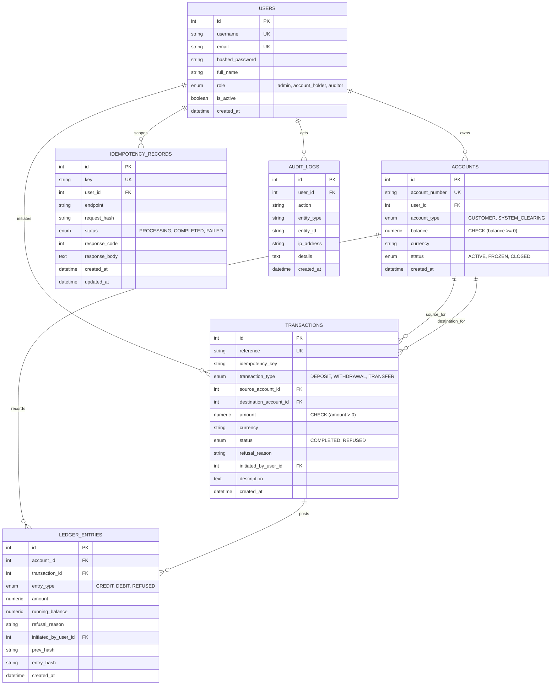

# LedgerLine — Database Schema & Data Architecture

> **Complete Database Schema & Relational Specifications**  
> Covers PostgreSQL (Neon) and SQLite data structures, integrity constraints, and cryptographic hash chaining.

---

## 1. Entity-Relationship Diagram (Mermaid)

---

## 2. Table Specifications

### 2.1 `users` Table
Stores authentication credentials and roles.
* `id` (`INTEGER`, Primary Key, Autoincrement)
* `username` (`VARCHAR(50)`, Unique, Not Null, Indexed)
* `email` (`VARCHAR(100)`, Unique, Not Null, Indexed)
* `hashed_password` (`VARCHAR(255)`, Not Null): Native bcrypt hash.
* `full_name` (`VARCHAR(100)`, Not Null)
* `role` (`VARCHAR(20)`, Enum: `admin`, `account_holder`, `auditor`, Not Null)
* `is_active` (`BOOLEAN`, Default `TRUE`, Not Null)
* `created_at` (`TIMESTAMPTZ`, Default `UTC NOW`, Not Null)

---

### 2.2 `accounts` Table
Stores bank accounts with strict non-negative constraints.
* `id` (`INTEGER`, Primary Key, Autoincrement)
* `account_number` (`VARCHAR(50)`, Unique, Not Null, Indexed, e.g. `ACC-101`)
* `user_id` (`INTEGER`, Foreign Key &rarr; `users.id`, Nullable for system accounts)
* `account_type` (`VARCHAR(20)`, Enum: `CUSTOMER`, `SYSTEM_CLEARING`, Not Null)
* `balance` (`NUMERIC(18, 4)`, Default `0.0000`, Not Null):
  **Constraint**: `CONSTRAINT chk_account_balance_non_negative CHECK (balance >= 0)`
* `currency` (`VARCHAR(10)`, Default `'INR'`, Not Null)
* `status` (`VARCHAR(20)`, Enum: `ACTIVE`, `FROZEN`, `CLOSED`, Not Null)
* `created_at` (`TIMESTAMPTZ`, Default `UTC NOW`, Not Null)

---

### 2.3 `transactions` Table
Records the business-level intent and resolution of each money-moving request.
* `id` (`INTEGER`, Primary Key, Autoincrement)
* `reference` (`VARCHAR(100)`, Unique, Not Null, Indexed, e.g. `TXN-8F1A2C3D`)
* `idempotency_key` (`VARCHAR(255)`, Nullable, Indexed)
* `transaction_type` (`VARCHAR(20)`, Enum: `DEPOSIT`, `WITHDRAWAL`, `TRANSFER`, Not Null)
* `source_account_id` (`INTEGER`, Foreign Key &rarr; `accounts.id`, Nullable for deposits)
* `destination_account_id` (`INTEGER`, Foreign Key &rarr; `accounts.id`, Nullable for withdrawals)
* `amount` (`NUMERIC(18, 4)`, Not Null):
  **Constraint**: `CONSTRAINT chk_transaction_amount_positive CHECK (amount > 0)`
* `currency` (`VARCHAR(10)`, Default `'INR'`, Not Null)
* `status` (`VARCHAR(20)`, Enum: `COMPLETED`, `REFUSED`, Not Null)
* `refusal_reason` (`VARCHAR(255)`, Nullable, e.g. `INSUFFICIENT_FUNDS`, `UNAUTHORIZED_ACCOUNT_ACCESS`)
* `initiated_by_user_id` (`INTEGER`, Foreign Key &rarr; `users.id`, Not Null)
* `description` (`TEXT`, Nullable)
* `created_at` (`TIMESTAMPTZ`, Default `UTC NOW`, Not Null)

---

### 2.4 `ledger_entries` Table
Immutable double-entry ledger rows with cryptographic hash chaining.
* `id` (`INTEGER`, Primary Key, Autoincrement)
* `account_id` (`INTEGER`, Foreign Key &rarr; `accounts.id`, Not Null, Indexed)
* `transaction_id` (`INTEGER`, Foreign Key &rarr; `transactions.id`, Not Null, Indexed)
* `entry_type` (`VARCHAR(20)`, Enum: `CREDIT`, `DEBIT`, `REFUSED`, Not Null)
* `amount` (`NUMERIC(18, 4)`, Not Null)
* `running_balance` (`NUMERIC(18, 4)`, Not Null): The exact balance after this entry.
* `refusal_reason` (`VARCHAR(255)`, Nullable)
* `initiated_by_user_id` (`INTEGER`, Foreign Key &rarr; `users.id`, Not Null)
* `prev_hash` (`VARCHAR(64)`, Not Null): SHA-256 hash of previous entry for this account (`GENESIS` if first entry).
* `entry_hash` (`VARCHAR(64)`, Not Null): Current block hash:
  $$\text{SHA256}(\text{prev\_hash} \mid \text{account\_id} \mid \text{txn\_id} \mid \text{type} \mid \text{amount} \mid \text{running\_balance} \mid \text{timestamp})$$
* `created_at` (`TIMESTAMPTZ`, Default `UTC NOW`, Not Null)

---

### 2.5 `idempotency_records` Table
Prevents double execution of network retries and double-clicks.
* `id` (`INTEGER`, Primary Key, Autoincrement)
* `key` (`VARCHAR(255)`, Unique, Not Null, Indexed)
* `user_id` (`INTEGER`, Foreign Key &rarr; `users.id`, Not Null, Indexed)
* `endpoint` (`VARCHAR(255)`, Not Null)
* `request_hash` (`VARCHAR(64)`, Not Null): `SHA256(endpoint + canonical_sorted_json)`
* `status` (`VARCHAR(20)`, Enum: `PROCESSING`, `COMPLETED`, `FAILED`, Not Null)
* `response_code` (`INTEGER`, Nullable)
* `response_body` (`TEXT`, Nullable)
* `created_at` (`TIMESTAMPTZ`, Default `UTC NOW`, Not Null)
* `updated_at` (`TIMESTAMPTZ`, Default `UTC NOW`, Not Null)

---

### 2.6 `audit_logs` Table
Comprehensive system security audit trail.
* `id` (`INTEGER`, Primary Key, Autoincrement)
* `user_id` (`INTEGER`, Foreign Key &rarr; `users.id`, Nullable)
* `action` (`VARCHAR(100)`, Not Null, Indexed, e.g. `LOGIN_SUCCESS`, `TRANSFER_COMPLETED`, `TRANSFER_REFUSED`)
* `entity_type` (`VARCHAR(50)`, Nullable)
* `entity_id` (`VARCHAR(100)`, Nullable)
* `ip_address` (`VARCHAR(50)`, Nullable)
* `details` (`TEXT`, Nullable)
* `created_at` (`TIMESTAMPTZ`, Default `UTC NOW`, Not Null, Indexed)
